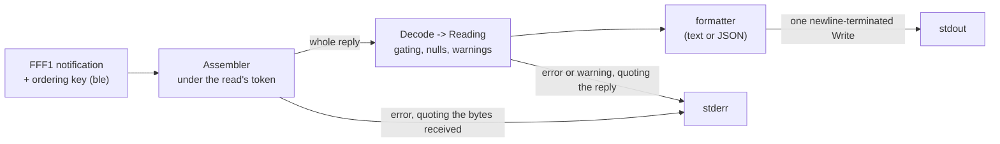

# Architecture overview

This is how the pieces of `go-pwr` fit together, for someone about to change the code. It describes the code as built. It does not repeat the contract, which is [decision 0001](../decisions/0001-go-pwr-design.md) (flags, exit statuses, output keys), or the wire format and the evidence behind it, which is [the protocol reference](../reference/protocol.md). When this page and either of those seem to differ, see "Where the code goes past the decision" at the end.

## Components

### `cmd/go-pwr`

The command. It owns everything a person or a supervisor sees:

- Flags and usage errors (`flags.go`, `main.go`): a usage error exits 2, and `--mac` missing in a machine mode exits 1 before any Bluetooth call.
- The three modes: one-shot (`run.go`), `--poll` (`loop.go`) and `--follow` (`follow.go`).
- Start-to-start timing (`pollLoop` in `loop.go`): the interval runs from the start of one reading to the start of the next, and a reading that runs long is followed at once by the next, with the missed intervals not made up.
- Choosing the controller from a scan (`select.go`).
- Exit statuses and signal handling: SIGINT and SIGTERM cancel the reading in progress, close the link on the way out, and end a loop with status 0.
- Printing: a reading to stdout, and every error and warning to stderr, one line each.

### Reply assembly: `status/assemble.go`, `status/completion.go`

The `Assembler` turns the notifications of one read into one whole reply.

- Each read has a `Token`. A notification added under an earlier read's token is dropped, so a late fragment of one read can't land in the next.
- Each notification carries an ordering key, and the keys must be strictly increasing. A key at or below the request's boundary predates the request and is dropped.
- *Whole* is the rule from decision 0001: a leading space, the body of 32 fields, `\r\n`. The `\r\n` is the completion marker, so a whole reply needs no timer.
- A read starts its reply at the first space and throws away what came before. A second space restarts the read there, because a space only ever starts a reply. The reasons, and what this does not catch, are in protocol.md, "Link after SIGKILL".
- A cut-off or silent reply is given up on, using the limits in `completion.go` (`FirstNotificationTimeout`, `GapTimeout`, `TotalTimeout`), which are set from the lola capture. The error keeps the bytes received so far.

### Decoding: `status/decode.go`, `status/codes.go`, `status/tempcheck.go`, `status/widths.go`

`Decode` turns a whole reply into a `Reading`.

- Three fields gate the reading: battery voltage, PV voltage and charge current. If one fails to decode or is outside what five digits can carry, the reading fails. The bounds come from the field format, never from what the captures happened to show.
- Every other field is `nil` (JSON `null`) when it fails, and its error goes in `FieldErrors`. It never suppresses the reading.
- Warnings never gate. The °C/°F check (`tempcheck.go`) warns when the two temperatures disagree beyond rounding. The width backstop (`widths.go`) warns when a field's width differs from every real capture, which a misplaced chunk can cause.
- `codes.go` holds the names and labels for charge state and battery type. An unknown code is never an error.

### Formatting: `status/format.go`, `status/format_text.go`, `status/errline.go`

- `format.go` writes the JSON line: half-up rounding of volts and amps, every key always present, one newline-terminated `Write`.
- `format_text.go` writes the text block.
- `errline.go` writes the stderr lines. A reply that was received is quoted as a Go string, so its bytes can't break the line or forge another.

### `ble`

The Bluetooth layer. It uses `tinygo.org/x/bluetooth` for BlueZ, and calls BlueZ's D-Bus API directly where the library can't keep a promise (notification order, cancelling a connect).

- Startup errors are classified (`ErrNoAdapter`, `ErrAccessDenied`, `ErrBlueZNotRunning`, `ErrAdapterUnavailable`). `Open` returns them marked `ErrFatalAtStartup`, and the same conditions after startup are `ErrRetryable`.
- The scan stops at the `--mac` match. It runs its full window only without `--mac`, and returns everything it heard.
- Connect makes the link with a D-Bus call that a context can cancel. When the context ends it tells BlueZ to disconnect and waits for the link to go down.
- `ConnectWithRetry`, which every reading connects through, first drops a link that is already up (`dropLeftover`), then connects. A reading never sends its request on a link go-pwr did not make.
- In-order delivery (`order.go`, `readbuf.go`): the notifications and the request share a D-Bus connection of their own with a sequential signal handler, and the signal's sequence number is the ordering key.
- `RequestStatus` is the one write to the controller: the single byte `0x20` to FFF2. `ble` exports no function that accepts bytes to write, and `TestNoExportedByteWriter` and `TestSingleStatusWriteCallSite` guard that.
- `Follower` (`follow_linux.go`) holds one connection for `--follow`. It checks the link's `Connected` property before and during a read, so a dropped link ends the read at once as `ErrLinkDropped`. Its splice prevention is to reconnect after any failed or cut-off reading, as the package documentation names it.

### `internal/boot`

`boot_id` and `CLOCK_BOOTTIME` uptime, for staleness. lola has no real-time clock, so the wall clock can step, and these two let a consumer tell how old a reading is.

### `internal/btmon`

Parses a `btmon` trace and checks that go-pwr wrote only what decision 0001 allows: `0x20` to FFF2, and notification-descriptor writes. It is used by the hardware tests on lola, not by the command.

### Pure code, and other platforms

`status` imports no Bluetooth or D-Bus package, so other Go programs can import it and its tests run anywhere. `internal/boot` reads Linux files and returns an unsupported-platform error elsewhere. On a non-Linux OS the whole module still builds, and every operation in `ble` returns `ErrUnsupportedPlatform`.

## Data flow

A notification arrives from BlueZ with its D-Bus sequence number as its key. `ble` hands the assembler each one in that order. The assembler, under the read's token, builds a whole reply or gives up. `Decode` turns the whole reply into a `Reading`. The formatter writes it as one newline-terminated `Write` on stdout. Errors and warnings go to stderr, one line each, and quote any reply that was received.

In-order delivery from `ble` is the only guard against reordered notifications. Nothing in the reply's content catches a reorder: most chunk swaps still pass the whole-reply rule, and one reports a healthy battery as 0.00 V. The proof is the reorder unit test (`status/reorder_test.go`, with the ordering tests in `ble/order_test.go`). The soak on lola that would show the ordering holding over hours (issue 01a17532-608a) is pending, deferred by perigrin, so it is not yet evidence.

## Deployment on lola

One process owns the controller: `go-pwr --poll --format json --mac C3:00:00:58:51:40`. The controller appears to accept one connection at a time, and `go-pwr` does not arbitrate between consumers, so nothing else should run a reading against it.

It runs under a supervisor, systemd. The arrangement as it is installed on lola, in prose, since decision 0001 makes units and packaging non-goals and the repository ships no unit file:

- A unit named `go-pwr.service` runs `/usr/local/bin/go-pwr` as an unprivileged `go-pwr` system user. BlueZ's D-Bus policy lets any user talk to it, so no privilege is needed.
- stdout is appended to `/var/log/go-pwr/readings.jsonl`. That log is all the shutdown script and the dashboard read, and stdout carries only successful readings. The directory is made when go-pwr is installed, not by the unit's `LogsDirectory`, because systemd opens an `append:` file before it creates that directory, and the first start would fail.
- stderr goes to the journal.
- The unit sets `Restart=always` and `RestartSec=5`. The restart is what clears the startup errors that exit 1: no adapter, BlueZ access denied, BlueZ not running, adapter off or blocked.
- The unit sets `StartLimitIntervalSec=0`. An adapter that isn't up at boot fails startup in under a second, and systemd's default start limit would stop restarting after five quick failures and leave the unit failed.

### Why `--follow` must never feed the shutdown script

Decision 0001's reason is that each `--poll` reading gets a fresh connection, so a late tail of an earlier reply can't be spliced into it, while on a held `--follow` connection nothing in the content stops a splice as long as the °C/°F check only warns. `--follow` also locks the phone app, and any other consumer, out for as long as it runs. `--poll` leaves the controller free between readings.

The code as built is stronger than the decision says here. A `Follower` reconnects after any failed or cut-off reading, which is where a tail of an earlier reply could come from, and the assembler restarts at a second space. Neither is a proof that no splice can happen on a held connection, and the decision's text is pending perigrin's review on this point. Until he decides, the rule stands: the shutdown feed uses `--poll`.

### Staleness

Silence means the controller is unreachable: out of range, powered down, or the phone app connected to it. It does not mean a low battery. A reading's age is the current uptime (the first number in `/proc/uptime`) minus its `uptime_s`, and it only counts when its `boot_id` matches the current boot.

### Hardware tests

Hardware tests on lola need the owner process stopped (`sudo systemctl stop go-pwr`) and started again afterwards. The tests need the controller to themselves, and a second go-pwr on the machine disconnects the owner's link mid-reading rather than sharing it.

### After a kill

go-pwr disconnects on every exit it controls. After a SIGKILL BlueZ keeps the link up indefinitely (protocol.md, "Link after SIGKILL"). The next reading drops that link before it connects, so it never sends its request on the killed run's link. If the link won't go down within the reading's timeout, because BlueZ refuses or another client holds it, the reading fails.

## Finding the address

This is an accepted risk (decision 0001, "Finding the controller"). A device with an active connection usually stops advertising, so while the phone app holds lola's controller, a neighbour's controller can be the only one visible, and a one-shot without `--mac` reads it. The harm is a person pinning the neighbour's address into `--mac`, and the shutdown script then watching the wrong battery.

The check before pinning an address into `--mac`: close the phone app first, and confirm that the reading matches what the app shows.

Two hazards have no automated test, because they need a real-world condition: the phone app holding the link, and several controllers in range. Both are covered by this check and by the people running the tool, not by the test suite.

## Where the code goes past the decision

- **`--follow` and splices.** Decision 0001 (see "Sharing the controller", and the lines on the temperature check and on the shutdown feed) says nothing stops a splice in `--follow` mode. The code now reconnects after any failed or cut-off reading and restarts reply assembly at a second space. The rule that the shutdown feed uses `--poll` is unchanged; the decision's wording awaits perigrin.
- **Leftover links.** The decision says each run must work if a previous one left a link behind. The code does it by dropping any link it did not make before every connect, and failing the reading if the link won't go down. The decision doesn't describe that drop.
